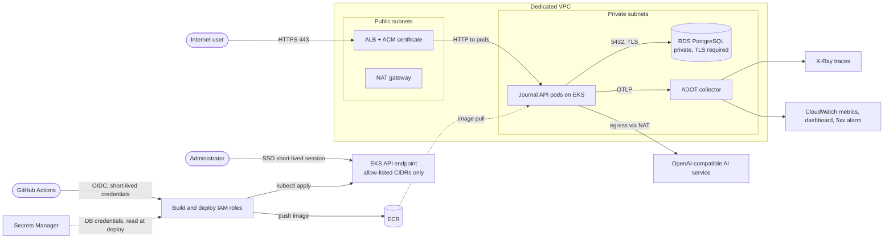

# Journal API on AWS: Terraform, EKS, GitHub Actions CD, OpenTelemetry

A FastAPI + PostgreSQL journaling API with AI-powered entry analysis, deployed to AWS with infrastructure as code and a fully automated pipeline. A push to `main` runs tests, builds a commit-tagged image, deploys to Kubernetes, and verifies the live `/version` endpoint reports the exact commit that shipped.

**Live API:** `https://<TODO your-domain>` (docs at `/docs`) *(taken down after verification; see [Evidence](#evidence))*
**Demo recording:** `<TODO link>`

> **Learning environment only:** authentication uses shared bearer tokens with no per-user data isolation. Do not store personal or sensitive journal content in it.

## Architecture

Three traffic paths:

| Path | Route |
|---|---|
| **Public** | Internet → ALB (ACM certificate, HTTPS) → pods in private subnets |
| **Private** | Pods → RDS on port 5432 over TLS. RDS has no public access. |
| **Administrative** | Short-lived IAM Identity Center session → restricted EKS API. GitHub deploys through OIDC roles, with no stored AWS keys. |

## Stack and why I chose it

| Need | Choice | Why |
|---|---|---|
| App | FastAPI, Python, `uv` with a lockfile | Reproducible installs |
| Container | Dockerfile with digest-pinned base images, `GIT_SHA` build arg | Reproducible builds; `/version` returns the deployed commit |
| IaC | Terraform with S3 remote state (versioned, encrypted, locked) | Reviewable, repeatable infrastructure |
| Orchestration | EKS, Kubernetes manifests applied with `kubectl` | Managed control plane, standard manifests |
| Database | RDS PostgreSQL, encrypted, private subnets | Managed, separate private tier |
| Secrets | Secrets Manager, GitHub environment secrets | Nothing sensitive in the repo or logs |
| TLS | ACM certificate, ALB via AWS Load Balancer Controller | Trusted HTTPS without managing certs in-cluster |
| CI/CD | GitHub Actions: `test` → `build` → `deploy` | Gated, auditable, commit-tagged |
| Observability | OpenTelemetry → ADOT collector → X-Ray + CloudWatch | Traces, metrics, and logs in one place |

## CI/CD pipeline

`.github/workflows/ci.yml` has three jobs, each depending on the previous one:

1. **test:** lint (`ruff`), type check (`pyright`), and `pytest`.
2. **build:** builds the image tagged with the full commit SHA and pushes it to ECR using a build-only OIDC role.
3. **deploy:** runs in the protected `production` environment (reviewer approval, `main` only). It uses a separate deploy role, applies the manifests, waits for rollout, and checks `GET /version` over HTTPS.

Pull requests run tests and a local image build without receiving AWS credentials.

## Security and access controls

- RDS accepts connections from the application tier only, and is not publicly accessible.
- Separate build and deploy roles with least privilege. The build role can only push to ECR. The deploy role can only read the two database secrets and access the cluster.
- The runtime database role is created by a short-lived Kubernetes Job. Its temporary admin secret is deleted afterwards.
- Terraform state is in a private, versioned, encrypted S3 bucket with public access blocked and TLS-only access.
- The EKS API is restricted to allow-listed CIDRs (never `0.0.0.0/0`).
- Secrets are never committed. `.env` and `terraform.tfvars` are ignored by Git and excluded from the image.
- Logs are structured JSON and contain no credentials or journal text.
- Ordinary journal operations need an access token. Both DELETE endpoints need a separate admin token.

## AI analysis

- **Provider and model:** `<TODO provider>` / `<TODO model name>`, called via an OpenAI-compatible API.
- **Safety controls:** `<TODO confirm each against your code and delete any that are not true>`
  - API key supplied only as an environment secret
  - Request timeout so `/analyze` returns within 30 seconds
  - Response validated to `sentiment` ∈ {positive, negative, neutral}, a non-empty summary, and a non-empty topic list
  - Input length limits
  - Journal text not written to logs

## Observability

- OpenTelemetry instrumentation: FastAPI auto-instrumentation, a custom `journal.version.lookup` span, plus request count, request duration, and 5xx metrics.
- Traces go to **X-Ray**, metrics to the **CloudWatch** `JournalAPI` namespace, and container logs to **CloudWatch Logs**.
- A CloudWatch dashboard shows request rate, p95 latency, and 5xx errors.
- A 5xx alarm notifies via SNS email.

*Screenshots: `docs/evidence/` (see below).*

## Cost

Estimated monthly cost while running: **`$TODO`** (`<region>`, from the AWS Pricing Calculator: `<link>`). An AWS Budget alert is set at **`$TODO`**.

| Item | Estimate |
|---|---|
| EKS control plane | `$TODO` |
| Worker nodes (EC2) | `$TODO` |
| RDS PostgreSQL | `$TODO` |
| NAT gateway (single, cost-saving tradeoff) | `$TODO` |
| ALB | `$TODO` |
| CloudWatch / X-Ray / ECR / Secrets Manager | `$TODO` |

Resources are destroyed after verification. Billing dashboard checked on `<TODO date>`: `<TODO result>`.

## Evidence

| Constraint | How it was verified | Evidence |
|---|---|---|
| Public HTTPS with a trusted certificate | `curl -sI https://<domain>/version`, browser padlock | `docs/evidence/tls.png` |
| Database private, app tier only | RDS "Publicly accessible: No", security group allows only the app tier | `docs/evidence/rds-private.png` |
| Management access private and authenticated | EKS API CIDR allow-list, SSO session | `docs/evidence/eks-access.png` |
| No secrets in source or logs | Secret scan of repo history, log review | `docs/evidence/secrets-check.md` |
| Survives restarts and my session ending | Deleted a pod, entries persisted | `docs/evidence/persistence.md` |
| CRUD and AI analysis work | `POST /entries`, `POST /entries/{id}/analyze` responses | `docs/evidence/api.md` |
| Cost estimated and budget alert set | Pricing Calculator + AWS Budget | `docs/evidence/budget.png` |
| Deployed commit matches `main` | `/version` equals the commit SHA | `docs/evidence/version.png` |

## Known limitation

Authentication uses two shared bearer tokens, so there are no user accounts and no per-user data isolation. Before production I would add per-user authentication (for example Cognito or another OIDC provider), scope every query to the authenticated user, and use a Multi-AZ NAT setup for resilient egress.

## Documentation

- [Deploy, operate, and troubleshoot](docs/deploy.md)
- [Local development and testing](docs/reference/testing-and-ci.md)
- [Troubleshooting](docs/reference/troubleshooting.md)

Built from the [Learn to Cloud](https://learntocloud.com) Journal API starter.

## License

MIT. See [LICENSE](LICENSE).
